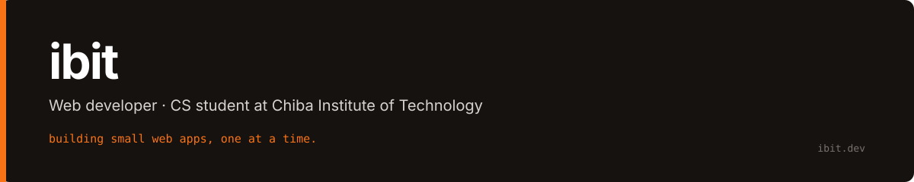
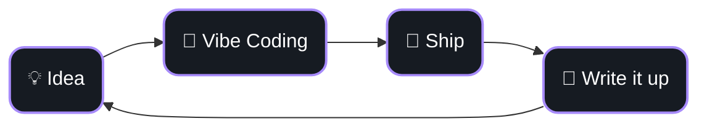

    

## `01` About

I'm a Computer Science student at **Chiba Institute of Technology** and an indie developer.
I love building products with AI — a.k.a. *Vibe Coding* — and sharing what I learn along the way.

| | |
|:---|:---|
| 🎓 **Education** | Chiba Institute of Technology — B.S. in Computer Science |
| 🚀 **Currently Building** | **BitCore** — an AI-powered company operations service |
| 💡 **Interests** | Web Development · AI · Indie Dev · Vibe Coding |
| 🌐 **Website** | [ibit.dev](https://ibit.dev/) |

## `02` How I Work

## `03` Stack

## `04` Activity

## `05` Projects

## `06` Connect

| | | | |
|:---:|:---:|:---:|:---:|
| **[𝕏 @ibit_cit](https://twitter.com/ibit_cit)** | **[in LinkedIn](https://www.linkedin.com/)** | **[Stack Overflow](https://stackoverflow.com/users/31543679/ibit)** | **[🌐 ibit.dev](https://ibit.dev/)** |
| **[Zenn](https://zenn.dev/ibit)** | **[Qiita](https://qiita.com/ibit)** | **[☕ Buy Me A Coffee](https://buymeacoffee.com/ibit)** | **[💜 GitHub Sponsors](https://github.com/sponsors/ibit)** |

