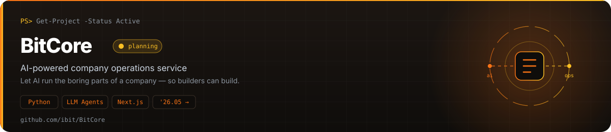
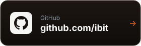
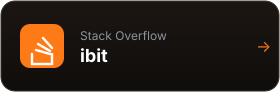

**OPERATE.** Runs official Japanese X and Discord communities for major mobile game titles. Server design, day-to-day operations, event and tournament support.

**BUILD.** Discord bots, spreadsheet and Google Apps Script systems, and AI-agent automation that take manual operations work off humans.

**FOUND.** **Scopit**, an SNS and community operations studio. **GLLITOPIA**, a Japanese ILLIT fan community with a custom multi-function Discord bot.

## Featured Projects

> **Now:** first year at Chiba Institute of Technology (informatics) · running official game communities · building Scopit · going deeper on AI automation and cybersecurity.
>
> Off the screen: kyudo, piano, K-POP (ILLIT).

#### Tech Stack

## GitHub Activity

## Latest Articles

Articles on [Zenn](https://zenn.dev/ibit) and [Qiita](https://qiita.com/ibit), updated automatically.

<!-- BLOG-POST-LIST:START -->
<!-- BLOG-POST-LIST:END -->

## Connect

  
  
  
  
   
  
  
  
  

