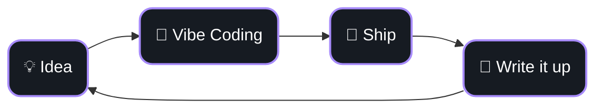

   

## `01` About

I'm a Computer Science student at **Chiba Institute of Technology** and an indie developer.
I love building products with AI — a.k.a. *Vibe Coding* — and sharing what I learn along the way.

| | |
|:---|:---|
| 🎓 **Education** | Chiba Institute of Technology — B.S. in Computer Science |
| 🚀 **Currently Building** | **BitCore** — an AI-powered company operations service |
| 💡 **Interests** | Web Development · AI · Indie Dev · Vibe Coding |
| 🌐 **Website** | [ibit.dev](https://ibit.dev/) |

## `02` How I Work

## `03` Stack

| Languages | Web | Infra & Tools |
|:---:|:---:|:---:|
|  |  |  |

## `04` Activity

## `05` Projects

| | Project | What it is | Stack | Status |
|:---:|:---|:---|:---|:---:|
| 🧠 | **[BitCore](https://github.com/ibit/BitCore)** | AI-powered company operations service | Python · AI |  |

## `06` Writing

 

## `07` Connect

   

  

